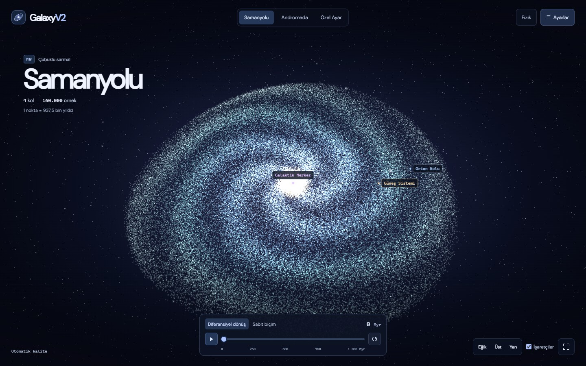
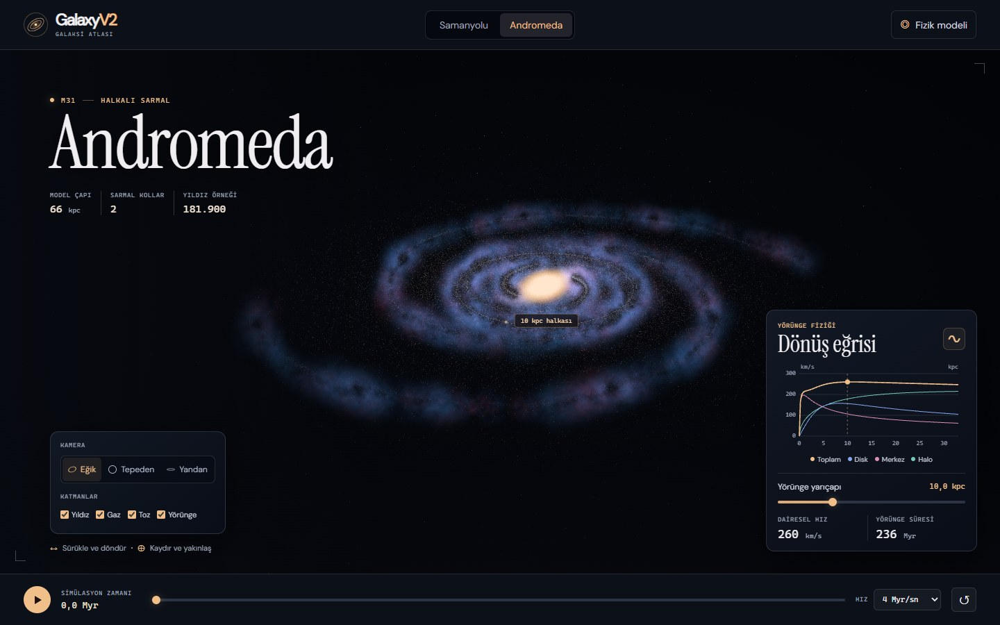

<div align="center">

# GalaxyV2

**Shape a galaxy in your browser**

[**Open the studio ↗**](https://hfatih.github.io/GalaxyV2/) · [Türkçe](README.tr.md) · [Controls](#controls)


[](LICENSE)

[](https://hfatih.github.io/GalaxyV2/)

</div>

GalaxyV2 brings the original [Samanyolu3D](https://github.com/hfatih/samanyolu3d) simulation into a new studio interface. Open the Milky Way, Andromeda or **Özel Ayar** (Custom). Change the arms and bend the disk while the 3D model stays in view. The original seeded geometry and preset values are preserved.

## Controls

| Panel | Setting | Range |
| --- | --- | --- |
| **Kollar ve disk** | Arm count | 2–8 |
| | Arm twist | 0–4 |
| | Arm spread | 0.05–1.2 |
| | Disk warp | 0–40 |
| **Yıldız popülasyonu** | Disk samples | 20,000–400,000 |
| | Bulge samples | 2,000–80,000 |
| | Halo samples | 2,000–100,000 |
| **Görünüm ve hareket** | Disk point size | 0.1–3 |
| | Rotation speed | 0–0.2 |
| | Dust layer | On/off |

Drag a slider or type a value next to it. **Sıfırla** restores the selected model’s defaults. **Özel Ayar** remembers its settings when you switch presets during the session.

| Camera action | Desktop | Touch |
| --- | --- | --- |
| Orbit | Left-drag | One-finger drag |
| Pan | Right-drag or arrow keys with the viewport focused | Two-finger drag |
| Zoom | Mouse wheel | Pinch |
| Change angle | **Eğik**, **Üst**, **Yan** | Same buttons |

**Yan** is the edge-on view for checking disk warp. The viewport also has a pause control and a toggle for the original Solar System, Orion Arm and galactic-center labels. The first two are Milky Way reference markers.

<details>
<summary>Andromeda in the studio</summary>



</details>

## How the model works

A seeded generator assigns samples to spiral arms, adds Gaussian spread, and bends the disk vertically. For arm index $k$, arm count $N$, radius $r$ and twist $T$, the nominal azimuth is $2\pi k/N + 0.02rT$. The warp uses a radially increasing sinusoid. The bulge and halo are sampled separately. The visualization rotates the complete galaxy group.

The sample scale divides the original presets’ reference population by the combined disk, bulge and halo sample count. Samanyolu3D uses 150 billion for the Milky Way and one trillion for Andromeda. These are reference values for the display. The scene uses model-space distances and contains illustrative landmark positions. See the original project’s [references](https://github.com/hfatih/samanyolu3d#-references--scientific-notes).

## Run locally

Node.js 22.12 or later and a WebGL-capable browser.

```sh
git clone https://github.com/hfatih/GalaxyV2.git
cd GalaxyV2
npm ci
npm run dev
```

```sh
npm test
npm run build
npm run preview
```

React renders the studio. Three.js and React Three Fiber render the scene. Vite builds the site into `dist/`. GitHub Pages serves that compiled output from the `gh-pages` branch. [Galaxy model](src/model.js) · [3D scene](src/Scene.jsx) · [Settings panel](src/Inspector.jsx)

The code is [MIT licensed](LICENSE). The bundled [DM Sans](assets/dm-sans-OFL.txt) fonts use the SIL Open Font License.
