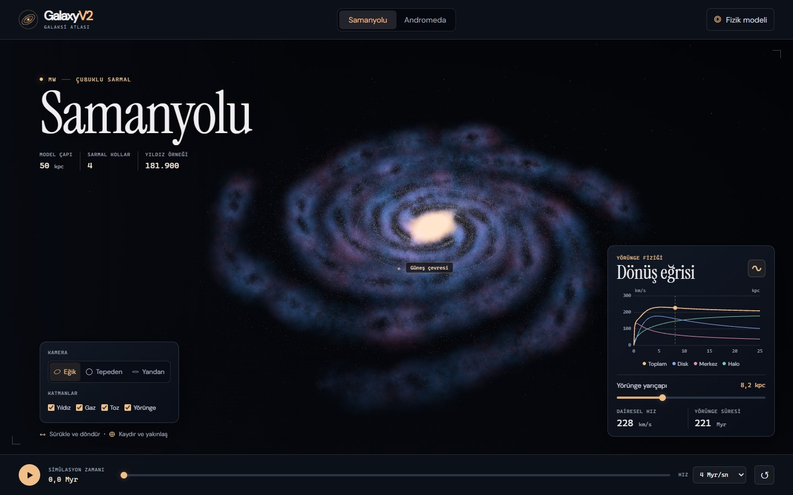
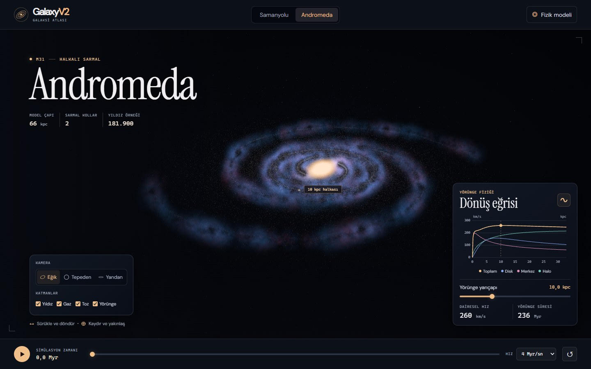

<div align="center">

# GalaxyV2

**Samanyolu ve Andromeda için etkileşimli 3B galaksi atlası**

[**Canlı atlası aç ↗**](https://hfatih.github.io/GalaxyV2/) · [English](README.md) · [Fizik modeli](#fizik-modeli)

[](https://hfatih.github.io/GalaxyV2/)

</div>

GalaxyV2, [Samanyolu3D](https://github.com/hfatih/samanyolu3d) projesinin sıfırdan yazılmış bağımsız sürümüdür. Dört sarmal kollu Samanyolu’nu ve 10 kpc yıldız oluşum halkasıyla Andromeda’yı inceleyebilirsin. Bir yörünge yarıçapı seçtiğinde işaretçi hem galakside hem de dönüş eğrisinde güncellenir.

## Atlası kullan

| Kontrol | İşlev |
| --- | --- |
| **Samanyolu / Andromeda** | Galaksi geometrisini, kütle profilini ve referans yörüngesini değiştirir. |
| **Eğik / Tepeden / Yandan** | Üç gözlem açısı arasında geçiş yapar. |
| **Sürükleme / iki parmak / fare tekeri** | Kamerayı döndürür veya yakınlaştırır. Sahne odaktayken ok tuşları ve +/− de çalışır. |
| **Yıldız / Gaz / Toz / Yörünge** | İlgili görselleştirme katmanını açar veya kapatır. |
| **Yörünge yarıçapı** | Dairesel hızı km/s, yörünge süresini Myr cinsinden hesaplar. |
| **Zaman çizgisi** | Simülasyonu duraklatır, seçili zamana götürür, sıfırlar veya oynatma hızını değiştirir. |

<details>
<summary>Andromeda görünümü</summary>



</details>

## Fizik modeli

Toplam kütleçekim potansiyeli üç parçadan oluşur. **Miyamoto–Nagai** basık yıldız diskini, **Hernquist** merkez şişkinliğini, **Navarro–Frenk–White** karanlık madde halosunu temsil eder. Düzlemdeki dairesel hız, toplam potansiyelin yarıçapa göre türevinden gelir.

$$
v_c^2(R)=R\,\left.\frac{\partial\Phi}{\partial R}\right|_{z=0}
=v_d^2(R)+v_b^2(R)+v_h^2(R)
$$

Samanyolu örneği 8,2 kpc’de **228 km/s** ve **221 milyon yıl** verir. Andromeda örneği 10 kpc’de **260 km/s** ve **236 milyon yıl** verir. Karşılaştırma için Eilers ve çalışma arkadaşları Güneş yakınında yaklaşık 229 km/s ölçtü. [Eilers vd. (2019)](https://arxiv.org/abs/1810.09466)

- **Yıldız diski.** Dairesel açısal hız yarıçapla değişir. Eski disk yıldızları görsel kalınlık ve bükülmeyi göstermek için örneklendikleri yükseklikte kalır.
- **Yörünge izi.** İşaretçi analitik kütleçekim kuvvetini kullanır. Kick–drift–kick leapfrog integratörü, her iz için en fazla 0,5 Myr uzunluğunda sabit adımlarla hesap yapar.
- **Sarmal yapı.** Logaritmik kolların eğimi ve desen hızı galaksiye göre değişir. Andromeda’da kolların üzerine yaklaşık 10 kpc yarıçaplı bir yıldız oluşum halkası eklenir. [Lewis vd. (2015)](https://arxiv.org/abs/1504.03338)

Potansiyel sabit ve eksenel simetriktir. Görsel sarmal kollar ve çubuk kütleçekim kuvvetine katılmaz. Yıldız örnekleri birbirini çekmez. Kütle değerleri ve ışık dağılımı eğitim ve keşif için seçilmiştir. [Denklemler, parametreler ve kaynaklar](README.md#the-physics)

## Yerelde çalıştır

Yerel sunucu ve testler için Node.js 22+, 3B sahne için WebGL 2 destekli bir tarayıcı gerekir.

```sh
git clone https://github.com/hfatih/GalaxyV2.git
cd GalaxyV2
npm run dev
```

[http://127.0.0.1:4173](http://127.0.0.1:4173) adresini aç. Uygulama tarayıcının yerleşik modül desteğini ve WebGL 2’yi kullanır. Paket kurulumu ve derleme adımı gerekmez. Canlı atlas GitHub Pages üzerinden `main` dalının kökünden yayımlanır.

```sh
npm test
```

Testler potansiyelin sayısal türevini, dönüş eğrisini, yarıçap sınırlarını, eğik ve eliptik yörüngede enerji ve açısal momentum korunmasını ve yıldız örneklemesinin tekrarlanabilirliğini denetler.

## Lisans

Kod [MIT](LICENSE) lisanslıdır. [Instrument Serif](assets/instrument-serif-OFL.txt) ve [DM Sans](assets/dm-sans-OFL.txt) kendi SIL Open Font lisanslarıyla dağıtılır.
